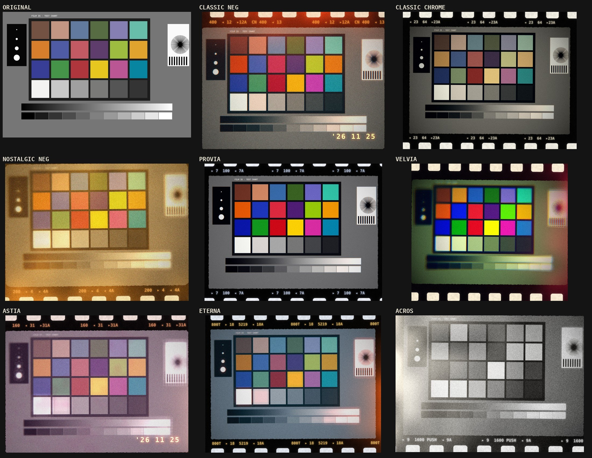

# film-camera

A 35mm film camera for the phone, built as a web page and wrapped in Hermit.

- Live viewfinder at the top of the phone (left or right side when turned sideways), showing the film look as you shoot.
- Taking a photo plays a shutter sound and blacks out the viewfinder. No preview, no gallery: photos go to Downloads as `FILM_<profile>_<date>.jpg`.
- Camera-body controls on black tolex: a knurled film dial, an exposure-compensation rocker (−2 to +2 EV in ⅓ stops) and a chrome shutter release.

## Profiles

Each dial position is a whole "camera": film colour, lens character and the accidents that come with it. The frame sits on a strip of 35mm film, so the cameras show the rebate, sprocket holes and edge printing in different ways.

| Dial | Camera | What you get |
|---|---|---|
| CN · Classic Neg | point & shoot, 400 colour neg | teal shadows, crimson reds, bold colour grain, sprocket holes along the top, orange date stamp, warm leaks |
| CC · Classic Chrome | rangefinder, reversal slide | muted, hard contrast, heavy vignette, full black film border with holes both sides, scratches |
| NN · Nostalgic Neg | 70s instamatic, expired 200 | amber, faded, soft corners, big halation and bloom, chemical stains, frequent warm leaks, crooked frame |
| PV · Provia | pro SLR, 100 slide | the cleanest: punchy and sharp, fine grain, slide-film border |
| VV · Velvia | plastic toy camera, cross-processed | green-yellow cast, huge saturation, strong chromatic aberration, blurry corners, deep vignette, red leaks |
| AS · Astia | compact, expired portrait film + soft filter | pastel pinks, milky blacks, heavy diffusion glow, stains, date stamp |
| ET · Eterna | cine camera, tungsten 800T | cool tungsten cast, glowing red halation round highlights, motion-picture perforations |
| AC · Acros | beat-up SLR, pushed B&W 1600 | huge grain, crushed blacks, dust and scratches, light fog |

Light leaks, scratches, dust and the tilt of the frame change on every shot, and only appear in the saved photo.

## Phone camera

Where the phone allows it, the camera is set up more like a film camera: white balance fixed to daylight (film is daylight balanced; Eterna uses a cooler, tungsten-leaning setting), continuous focus, no digital zoom, no torch, no flash, and exposure compensation done in the camera hardware. Anything the phone doesn't support is done in software instead.

## Hosting

Host the whole folder (`index.html`, `manifest.webmanifest`, `icons/`) anywhere with HTTPS (camera access requires it) and open it as a Hermit Lite App. Hermit can pick up the icon from the manifest or apple-touch-icon; if it doesn't, set it in Quick Settings → More Settings → Theme.
